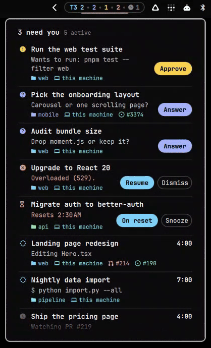
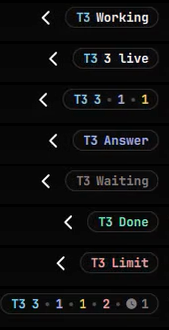
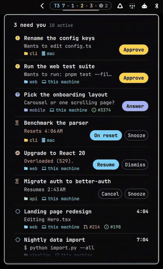
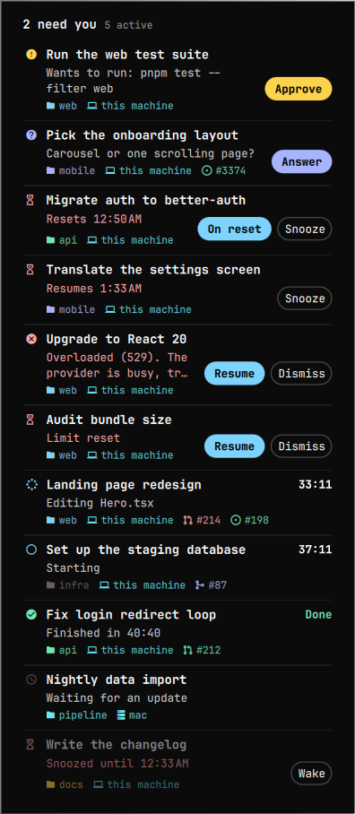
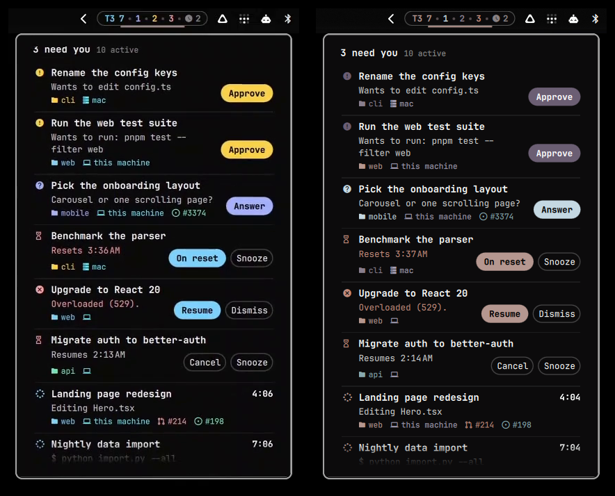
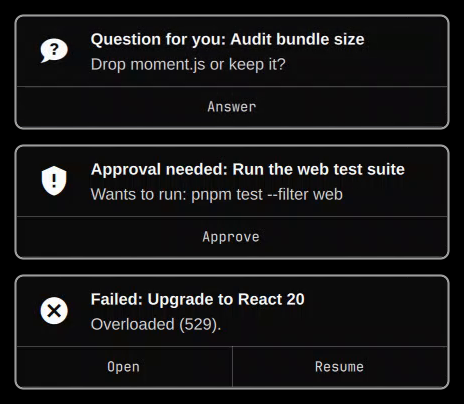

# T3 Live

A compact island for [T3 Code](https://t3.codes) agents in the [Omarchy](https://omarchy.org) bar.

<p align="center"><br><sub><a href="docs/island.mp4">Watch it as video (MP4, 60 fps)</a></sub></p>

It speaks the language of T3 Code's own mobile live notification: one word when one thread is running, colored counts when several are, and a short "Done" when one finishes. Click it for the list.

<p align="center"><br><sub><a href="docs/list.mp4">Watch the list as video (MP4): rows reorder live, a question arrives, a thread finishes, a limit is snoozed</a></sub></p>

## Philosophy

- **A glance, not a dashboard.** The bar says one thing: what your agents are doing, in one word or a few colored numbers. Nothing loops or blinks; it moves only when something changes, and it disappears when nothing needs you.
- **Choose, then go.** The list is for deciding where to go next: one row per thread, one line of what is happening now, and only the buttons that state needs.
- **Decisions happen where the context is.** Answering a question, approving a command or settling a thread needs the whole thread, so those open it in T3 Code. The list only does what needs no context: resume, wait for a limit, snooze, dismiss.
- **Mirror T3, don't fork it.** Its words, its colors, its resume message. It reads T3's state and never writes it; the only thing it keeps is a small plan file whose entries end on their own.
- **Fit Omarchy.** Theme surfaces, Omarchy's motion rules (short, ease-out, no bounce, off when animations are off) and plain-text safety for anything that comes from another machine.
- **Left out on purpose:** answering inline, a message box, history, usage meters (Omarchy's Agents widget has those), and settings beyond the few you might actually change.

## Install

```sh
omarchy plugin add https://github.com/EhsanulHaqueSiam/omarchy-t3-live.git --enable
```

It needs T3 Code on the same machine, in `~/.t3` (or `T3CODE_HOME`). `sqlite3` and `jq` come with Omarchy. Resume uses T3's own `t3` command, which T3 installs.

To remove it:

```sh
omarchy plugin remove siam.t3-live
rm -f "${XDG_STATE_HOME:-$HOME/.local/state}/omarchy-t3-live/plan.json"   # its plan file, if you want it gone too
```

## The island



- `T3 Working`: one thread is running.
- `T3 3 live`: only running threads.
- `T3 3·1·1`: a mix, as counts in T3's phase colors: running (sky), questions (indigo), approvals (amber), stopped (red), waiting and offline (gray). Hover for the names.
- `T3 Answer` / `T3 Approve`: the one thread needs you.
- `T3 Waiting` / `T3 2 waiting`: T3's own "Waiting": the turn ended, but the thread still watches a pull request whose checks are running (a deploy, CI) or that it waits to merge, has background work it is waiting for (a delegated thread, a task it will resume after), or waits on another thread. A dev server left running doesn't count, as in T3. It isn't done, so it never says Done while it waits; when the wait ends with its work finished it says Done, and if that work was cancelled it just leaves the list.
- `T3 Failed` / `T3 Limit` / `T3 Offline`: the one thread stopped, hit a usage limit, or its machine stopped answering.
- `T3 Done`: shown for a few seconds when a thread finishes; a waiting question or approval is never covered by it.

Nothing running and nothing stopped: the island fades out and gives its space back. It never animates on its own; it only moves when something changes.

<br clear="right">

## The list

One row per thread: the title, one line of what is happening now, and a line with its project (in the project's T3 color), its machine, its pull request (colored by state: open, failing, merged, closed) and its linked issue, each with its own icon. Each state shows only the buttons it needs:

| State | The line under the title | Buttons |
| --- | --- | --- |
| Working, starting | Its current step: `Editing Hero.tsx`, `$ pnpm test` | none (elapsed time) |
| Waiting | What it waits on: `Watching PR #76`, `Subagent: Watch the deploy`, `Waiting on another thread` | none (time waiting) |
| Question | The question | **Answer**: opens the thread in T3 |
| Approval | What it wants: `Wants to run: pnpm test` | **Approve**: opens the thread in T3 |
| Failed | The error | **Resume**, **Dismiss** |
| Usage limit | `Resets 4:00 PM` | **On reset** (resume when it resets), **Snooze** (hide until then) |
| Usage limit, resume planned | `Resumes 4:00 PM` | **Cancel**, **Snooze** |
| Usage limit, T3 will resume it | `Resumes 4:00 PM` | **Snooze** (none once it has reset) |
| Usage limit, reset | `Limit reset` | **Resume**, **Dismiss** |
| Snoozed | `Snoozed until 4:00 PM`, dimmed, at the end | **Wake** (only for snoozes made here) |
| Offline | `Machine not answering`, for 10 minutes | none |
| Done | `Finished in 12:04`, for 2 minutes | none |

Clicking a row opens its thread in T3. A long list scrolls inside a card about eight rows tall, and the headline comes back the moment you scroll up.

<p align="center"><br><sub><a href="docs/scroll.mp4">Watch it as video (MP4)</a></sub></p>

Every state in one long list, from the top and from the end:

<p align="center"></p>

## What it does, and what it leaves out

The bar is for a glance and the list is for choosing where to go. Anything that needs the thread's context, answering a question, approving a command, settling a thread, opens the thread in T3 Code, where you have all of it. The list only does what needs no context:

- **Resume** sends the thread T3's own `Continue where you left off.` through the `t3` command on the thread's machine. One click sends once.
- **On reset** resumes a usage-limited thread when its limit resets. If T3's own auto-resume is already armed for it, the plugin leaves it to T3.
- **Snooze** hides a usage-limited thread until its limit resets.
- **Dismiss** hides a failed thread here until it stops again. It does not settle the thread in T3: T3 has no way for other programs to settle a thread, so the plugin doesn't pretend to. Failed threads also leave on their own once you settle them in T3, or after 12 hours.

Plans (on reset, snooze, dismiss) are kept in `~/.local/state/omarchy-t3-live/plan.json` and end on their own when the thread moves on. Everything else is read from T3, never written: there is no inline answering, no message box, no history, and no usage meters (Omarchy's Agents widget has those).

## Colors

By default the phases use T3 Code's own vivid colors, the same ones as its web sidebar and mobile live notification; on a light theme they switch to their darker shades. Everything else, the island, the card, text and borders, follows your Omarchy theme and changes with it. Set the widget's **Colors** setting to **Theme** (`"colors": "Theme"` in its bar entry) to take the phase colors from the theme's palette too. Any color too faint for its background is lifted until it reads.

<p align="center"><br><sub>T3's colors (left) and <b>Colors: Theme</b> (right), on the same theme.</sub></p>

Rows move rather than jump: a thread that starts waiting on you glides to the top, a new one fades in, a finished one fades out, and colors ease when a state changes.

## Notifications



A toast arrives when a thread starts waiting on you, finishes, fails or hits a usage limit. Clicking a toast opens the thread; its buttons offer Resume, Resume at reset or Snooze where they apply. A question or approval still waiting after 5 minutes gets one more, critical toast. Turn toasts off with the widget's **Notifications** setting (`"notify": false` in its bar entry). A thread that starts waiting on a pull request or background work gets no toast: nothing needs you yet.

<br clear="right">

## Linked machines

Threads from T3 Code's linked environments show up on their own: the plugin asks T3 which environments are linked (`t3 environment list`), matches each one's address to an ssh alias in `~/.ssh/config` (or uses the address itself), and reads that machine's threads over key-based ssh. Turn this off with the widget's **Linked machines** setting. T3 itself doesn't let other programs read a linked environment, so a machine you can't ssh into isn't shown.

To add a machine by hand, put its ssh host in the widget's **Other machines** setting, or in its bar entry in `~/.config/omarchy/shell.json`:

```json
{ "id": "siam.t3-live", "sshHosts": "mac, server" }
```

Each host needs key-based ssh (the plugin connects with `BatchMode=yes`), T3 Code, `sqlite3` (macOS has it) and the `t3` command for Resume. Nothing gets installed there. A machine that stops answering shows its threads as offline for 10 minutes, and the plugin keeps trying every 30 seconds.

Opening a thread from another machine goes through the T3 Code desktop app, which knows your linked machines. Without the desktop app, it opens in this machine's T3 web UI, which only knows this machine's threads.

## Keyboard

`omarchy-shell siam.t3-live toggle` opens the list on the focused monitor. To bind it, add a line like this to `~/.config/hypr/bindings.conf`:

```
bindd = SUPER ALT, T, T3 agents, exec, omarchy-shell siam.t3-live toggle
```

`omarchy-shell siam.t3-live status` prints the counts and threads as JSON.

## How it works

`feed.sh` reads T3 Code's database (opened read-only) every 2 seconds and prints a line only when something changes. It runs once on this machine, and on each ssh host over one long-lived `ssh host sh -s`. If its query keeps failing (T3 changed its database), it stops, and that machine shows as offline instead of frozen. All bars share one set of feeds.

## Limits

- English only for now; other languages fall back to English.
- Numbers and layout don't yet follow right-to-left languages.
- It reads T3's internal database, so a T3 update can change what it can see; the feed then shows the machine as offline rather than guessing.

## Development

```sh
node tests/model.test.mjs   # the model: parsing, states, colors, plans
sh tests/feed.test.sh       # feed.sh against a fixture database: waiting, Done after a wait
omarchy plugin validate .
```

After editing the QML, run `omarchy-restart-shell`. Hot reload can keep the old widget.

MIT licensed.
